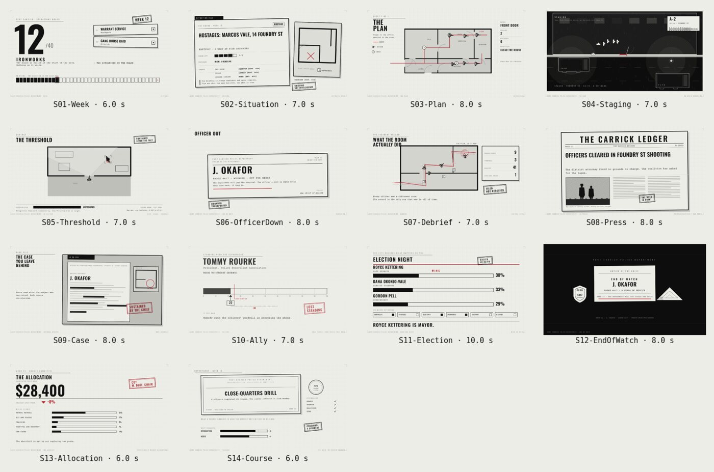

# The Violence: the cutscenes

Everything the game plays as video is made here with [Remotion](https://www.remotion.dev):
the four-minute opening, and the short interstitials the campaign can call at any beat.
All of it is drawn in the game's red-ink hand: paper, ink, stepped greys and one red that
only marks where a plan touched a real room. Every sound is one of the game's own
synthesised effects (`public/sfx`), plus a phone ring made for the opening's scene 2.

## The opening

Four scenes, played before a new campaign (and from the title's Prologue).

| # | Scene | Length | What it shows |
|---|-------|--------|---------------|
| 1 | Port Carrick | 42 s | the skyline and the closing mill, the twelve wards and four crews, gunfire on the map, headquarters |
| 2 | The Outgoing Chief | 41 s | the desk from above, the note the last chief left, what you inherit, the phone |
| 3 | The Plan | 43 s | a briefing drawn with total confidence, then the same house when the plan meets the room |
| 4 | Forty Weeks | 39 s | the calendar, the three candidates, the four allies, the first front page, the title |

## The short cutscenes



Fourteen interstitials, 5–10 s each, for the beats between the films: a week starting, a
situation picked off the board, the plan signed, staging in the street, the first door,
an officer down, the debrief, the front page, a case, an ally crossing 25, election night,
end of watch, the allocation, a course ending.

They are *prop-driven*, not scripted: the plates are drawn, the words come from the
campaign, and where a short publishes a **slot** the engine may paint its own text into an
empty plate at play time (a name, a badge, a ward, a headline) without re-rendering
anything. `SHORTS.md` is the generated catalogue: every prop, its type, its default, and
the slots each short publishes.

| id | Scene | Length | Fires on |
|----|-------|--------|----------|
| `S01-Week` | The Board Refills | 6 s | a week starts |
| `S02-Situation` | The File | 7 s | a situation is selected |
| `S03-Plan` | The Plan | 8 s | squads set, before RUN |
| `S04-Staging` | Staging | 7 s | RUN is pressed |
| `S05-Threshold` | The Threshold | 7 s | first door / first contact |
| `S06-OfficerDown` | Officer Down | 8 s | an officer is downed |
| `S07-Debrief` | The Fog Lifts | 7 s | an operation ends |
| `S08-Press` | The Front Page | 8 s | the press writes |
| `S09-Case` | The Case | 8 s | a case opens or closes |
| `S10-Ally` | The Standing | 7 s | an ally crosses 25 |
| `S11-Election` | Election Night | 10 s | week 40 |
| `S12-EndOfWatch` | End of Watch | 8 s | an officer is killed |
| `S13-Allocation` | The Allocation | 6 s | the budget committee rules |
| `S14-Course` | The Course | 6 s | a course ends |

```sh
npm install
npm run studio                         # Remotion Studio: every composition, the opening and the shorts
npm run render                         # the four opening scenes to out/*.mp4
npm run shorts                         # every short to out/shorts/*.mp4
npm run shorts -- S05-Threshold        # one short, and its variant props in Studio
npm run manifest                       # shorts.json + SHORTS.md + the game's copy
sh scripts/to_game-shorts.sh           # loudness-normalised masters, Ogg Theora into ../assets/cutscenes/shorts
```

`node scripts/render-shorts.mjs S01-Week --still=120` renders one frame; `--crf=21` and
`--concurrency=2` set the encode. Rendering uses `CHROME_PATH` if set, otherwise a
Playwright headless shell if present, otherwise Remotion's own browser download. The
Theora step needs an ffmpeg built with libtheora and libvorbis (Remotion ships one ffmpeg
that cannot encode either), so `to_game-shorts.sh` takes `FFMPEG=/path/to/ffmpeg`.

## How it fits together

```
src/ink.jsx              the opening's kit: paper, panels, captions, stamps, pen-drawn paths,
                         rain, the plan figure, a comic silhouette, sounds
src/C1..C4_*.jsx         one file per opening scene
src/shorts/registry.js   every short: id, key, frames, props, slots, trigger, sound
src/shorts/kit.jsx       the short-form kit: sheets, kickers, meters, markers, walkers, labels
src/shorts/S01..S14.jsx  one file per short, each a pure function of its props
src/shorts/index.jsx     the compositions, read straight off the registry
src/Root.jsx             the opening's compositions + the shorts' root
scripts/render.mjs       the opening to out/
scripts/render-shorts.mjs the shorts to out/shorts/
scripts/manifest.mjs     the catalogue the engine reads
scripts/to_game-shorts.sh the game copies
```

In the game, `scripts/ui/shorts.gd` plays them (a `CanvasLayer`, like the opening's
`cutscene.gd`) and paints slot text; `scripts/main.gd` exposes
`play_short(key, text, after)` and a `--short=s01_week` hook for recording one.
