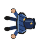
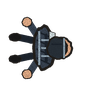
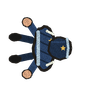
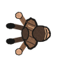
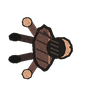
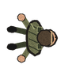
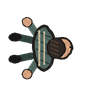
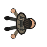

# Character roster

The game uses 2D, top-down animated character rigs. These are the neutral standing
asset previews; the live rig supplies moving arms, feet and weapons. Actual helmets,
armour, shields and other kit are separate overlays and do not come from a costume.

| Patrol | SWAT-style | Public order / riot |
| --- | --- | --- |
|  |  |  |
| Service cap and duty belt | Tactical clothing and webbing | Public-order stripes and soft cap |

The visor above is shown only when the officer actually has a helmet.

| Hoodie | Leather jacket | Work coat | Track jacket | Utility vest |
| --- | --- | --- | --- | --- |
|  |  |  |  |  |

Public-event officers use the public-order look. Outside events, the SWAT look is
used for tactical/quick-response officers or those equipped with plates or a helmet;
other officers use patrol. Campaign criminal clothing is chosen consistently from
the operation seed and person ID; city-mode gangs each use a clothing family. A
hidden attacker keeps a civilian appearance and label, with equipment concealed
until the reveal, including in replays. These choices do not change simulation stats.

Each look has vector source plus three textured frames for torso, head, standing,
downed and eight fall directions. The riot helmet/visor is a separate kit overlay.
Regenerate with `python3 tools/make_character_assets.py`; `--check` verifies the
committed files. The art tool requires the pinned Pillow version in
`tools/requirements.txt`; the game does not. The older crayon baker deliberately
leaves these specific sprites alone. Open the project in Godot to import assets.
